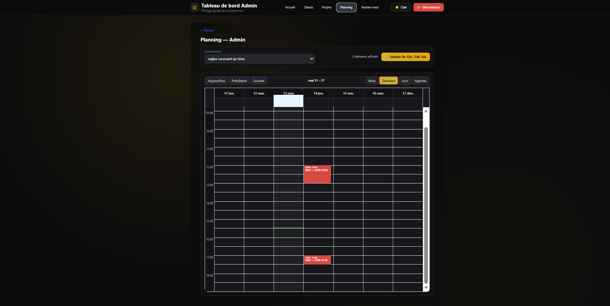
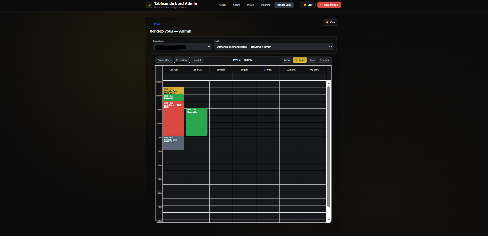

# 🏦 BankAdvisr - Consulting Management Platform

BankAdvisr est une application **Full-Stack** robuste conçue pour digitaliser et simplifier la relation entre les consultants bancaires et leurs clients. Elle permet un suivi précis des dossiers, une gestion documentaire sécurisée et une prise de rendez-vous fluide.

## 📱 Application Interfaces

### Authentication & Security
Accès sécurisé via Firebase Auth avec redirection selon le rôle (Admin, Consultant, Client).


### Dashboard & Tracking
Vue d'ensemble des projets avec calcul en temps réel du pourcentage d'avancement.


### Project Details & Documents
Gestion intelligente des fichiers. *Note : Le serveur nettoie automatiquement le stockage physique lors de la suppression d'un projet.*


### Planning & Calendar
Interface interactive pour la gestion des créneaux de consultation.



## 🛠️ Stack Technique

- **Frontend** : React.js, Tailwind CSS, Lucide Icons, React Big Calendar.
- **Backend** : Java Spring Boot 3, Gradle.
- **Base de données & Auth** : Google Firebase Firestore & Firebase Auth.
- **Sécurité** : JWT (JSON Web Tokens) & Spring Security.

## 🚀 Installation & Setup

### 1. Cloner le projet
```bash
git clone [https://github.com/Sahar-Gr/bankadvisr.git](https://github.com/Sahar-Gr/bankadvisr.git)
cd bankadvisr
